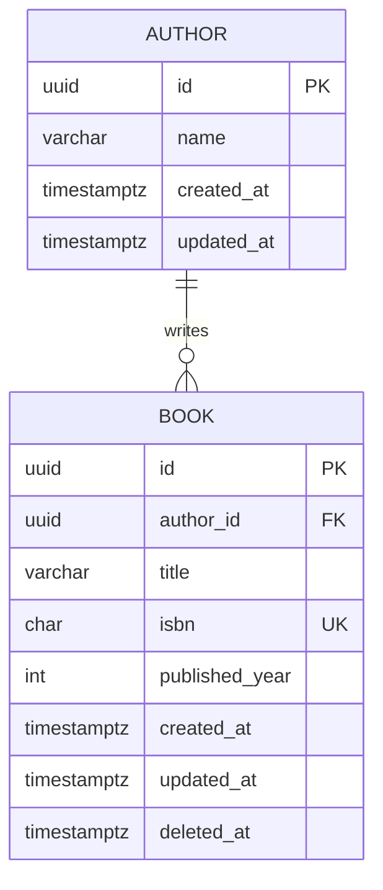

# Data Model

Template for the backend-api pack. Replace the example with your own tables. Keep this file, the TypeORM entities, and the migrations in sync: every task that adds a migration updates this file in the same commit.

## Conventions

- PostgreSQL. Table and column names in `snake_case`; TypeORM entity properties in camelCase.
- Primary keys: `uuid` generated by the database (`@PrimaryGeneratedColumn('uuid')`).
- Every table has `created_at` and `updated_at` (`timestamptz`). Tables that need soft delete add `deleted_at`.
- Uniqueness and foreign keys are enforced by the database, not only in code.
- Columns holding personal or sensitive data are marked **[PII]** with the reason they are stored.

## Entity-relationship diagram



## Tables

### `authors`

| Column | Type | Null | Default | Notes |
| --- | --- | --- | --- | --- |
| `id` | `uuid` | no | `gen_random_uuid()` | PK |
| `name` | `varchar(120)` | no | | |
| `created_at` | `timestamptz` | no | `now()` | |
| `updated_at` | `timestamptz` | no | `now()` | |

### `books`

| Column | Type | Null | Default | Notes |
| --- | --- | --- | --- | --- |
| `id` | `uuid` | no | `gen_random_uuid()` | PK |
| `author_id` | `uuid` | no | | FK → `authors.id`, `ON DELETE RESTRICT`, indexed |
| `title` | `varchar(200)` | no | | indexed (list filter) |
| `isbn` | `char(13)` | no | | unique |
| `published_year` | `int` | no | | check `>= 1450` |
| `created_at` | `timestamptz` | no | `now()` | |
| `updated_at` | `timestamptz` | no | `now()` | |
| `deleted_at` | `timestamptz` | yes | | soft delete |

## TypeORM entity example

```ts
@Entity({ name: 'books' })
@Index(['title'])
export class BookOrmEntity {
  @PrimaryGeneratedColumn('uuid')
  id!: string;

  @ManyToOne(() => AuthorOrmEntity, { nullable: false, onDelete: 'RESTRICT' })
  @JoinColumn({ name: 'author_id' })
  author!: AuthorOrmEntity;

  @Column({ type: 'varchar', length: 200 })
  title!: string;

  @Column({ type: 'char', length: 13, unique: true })
  isbn!: string;

  @Column({ name: 'published_year', type: 'int' })
  publishedYear!: number;

  @CreateDateColumn({ name: 'created_at', type: 'timestamptz' })
  createdAt!: Date;

  @UpdateDateColumn({ name: 'updated_at', type: 'timestamptz' })
  updatedAt!: Date;

  @DeleteDateColumn({ name: 'deleted_at', type: 'timestamptz' })
  deletedAt!: Date | null;
}
```

## Migration log

| Migration | Change | Task / change id |
| --- | --- | --- |
| `1700000000000-CreateAuthorsAndBooks` | Create `authors`, `books` | example |
